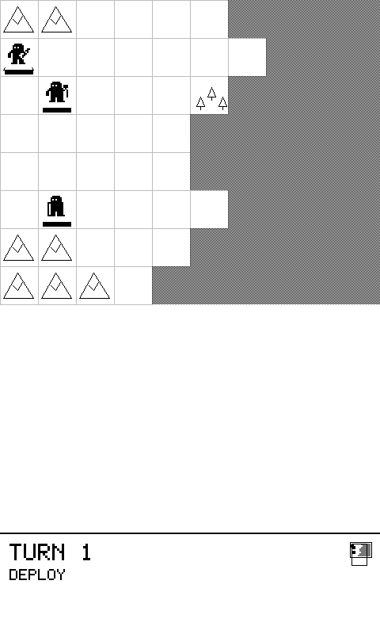
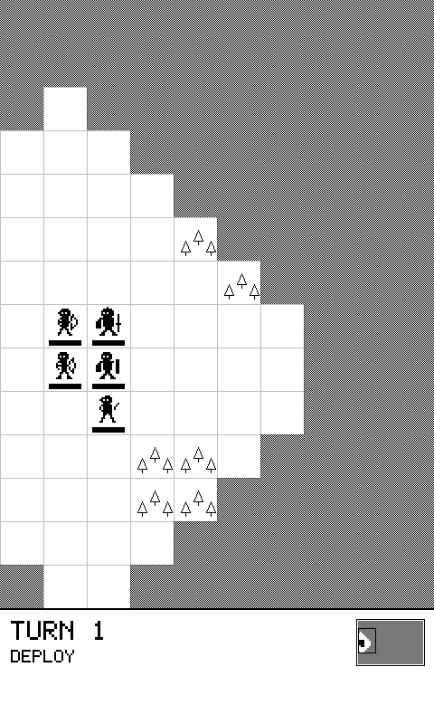
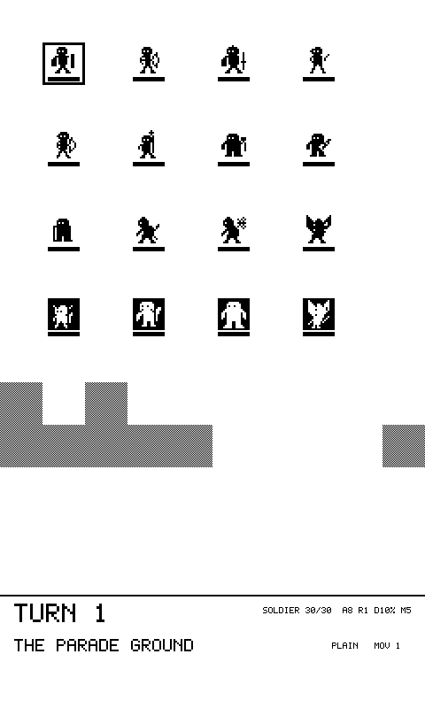

# Tactics — a turn-based strategy game inside the e-reader

This fork of [CrossPoint Reader](https://github.com/crosspoint-reader/crosspoint-reader)
adds a complete turn-based tactics game to the firmware: deterministic combat
with flanking and zones of control, fog of war, a flank-seeking AI, two story
campaigns, and battle save/resume — running on the ESP32-C3 next to the EPUB
engine it politely shares ~380 KB of RAM with. A full battle fits in 5.6 KB.



Open it from the home menu: **Home → Tactics**.

## Highlights

- **No dice.** Damage is `attack × (100 − defense)%` with terrain, racial, and
  flanking modifiers; the exact forecast is shown before every attack commits.
- **Geometry over randomness.** Flank bonuses for pincer positions, zones of
  control, parting blows on disengage, fog of war that remembers terrain.
- **An AI that hunts your backline** — it scores every reachable attack,
  prefers kills and flanks, refuses lethal counters, and routes idle units
  along a shared distance field instead of per-unit pathfinding.
- **E-ink aware.** Fast partial refresh for every action, scheduled full
  refreshes to wipe ghosting, and a paced enemy phase (one action per 650 ms)
  so you can actually watch the battle.
- **Power-off proof.** The whole game state is trivially copyable; saves are a
  versioned, CRC-guarded `memcpy`. Put the reader down mid-battle and resume.
- **Campaigns are folders.** Plain-text levels and `.story` interludes on the
  SD card, in filename order. Two campaigns ship in `data/tactics/`:
  *The Deep Road* and *The Broken Crown*.
- **Playtested by a bot in CI.** A threat-aware bot plays every shipped level
  on every test run and asserts survivor margins — "unwinnable" and "too easy"
  both fail the build. The tactics suite has 61 host tests.

| | |
|---|---|
|  |  |

## Where the code lives

The game is deliberately additive so it rebases cleanly onto upstream:

- `lib/Tactics/` — hardware-free rules engine (also compiles on the host)
- `src/activities/tactics/` — e-ink UI activity
- `data/tactics/` — campaigns and sample levels
- `test/tactics/` — GoogleTest suite + campaign playtest bot
- `test/tactics_sim/` — scriptable desktop simulator (BMP frame dumps; every
  screenshot above came out of it)

Only six upstream files are touched: the home menu (2), the activity manager
(2), the English translation file, and the test registry.

## Branches

- **`tactics`** (default) — upstream `develop` + the tactics commits
- **`develop`** — mirrors upstream `develop` exactly

## Writing your own levels

Levels are hand-editable text files dropped into `/tactics` on the SD card —
see [docs/tactics-levels.md](../docs/tactics-levels.md) for the format, the unit
bestiary, terrain rules, and the level-design notes.

## Building and running

Build and flash exactly like upstream CrossPoint (PlatformIO). To play on the
desktop instead, build the host tests and run the simulator:

```sh
cmake -S test -B build/test && cmake --build build/test --target TacticsSim
build/test/tactics_sim/TacticsSim data/tactics/deep_road/11_the_gates.yaml
```

All credit for the reader itself goes to the upstream
[CrossPoint Reader](https://github.com/crosspoint-reader/crosspoint-reader)
project — this branch only adds the game.

---

Looking for the reader itself? Upstream's own documentation is in the root [README.md](../README.md).
